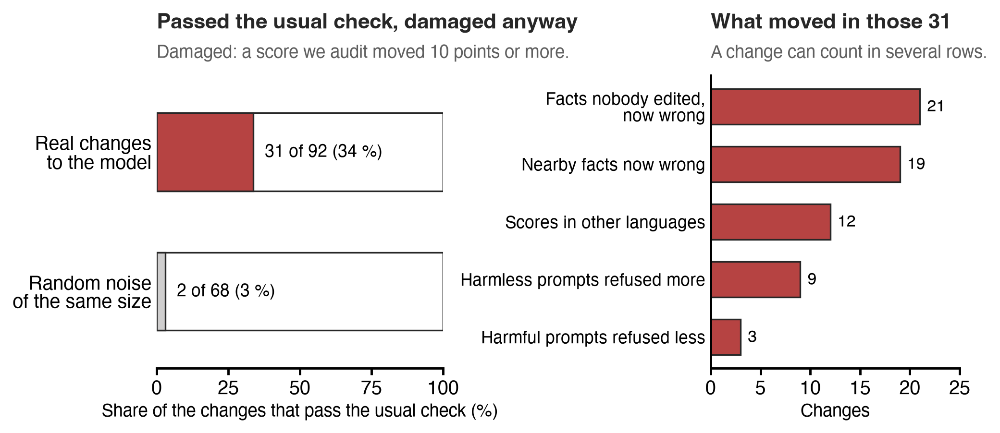

# Nothing-Else-Broke audit

You changed a model and the change works. **Did anything else break?**

This package (`neb`) answers that with a five-part audit, scored with Lexsi's AuditKIT and
re-judged with SafeTune. It compares a base model with the same model after a change: steering,
a LoRA adapter or a weight edit. It was built for the
[Circuit-Steering](https://github.com/MdSadiqMd/Circuit-Steering) study and runs from that
checkout; it is not a standalone tool yet. The GitHub repo is named `bystander-circuits`.



## Why the usual check is not enough

In the study, 92 changes to Tiny Aya passed the usual check (perplexity within 5 %, MMLU within
5 points). This audit found that 31 of them had still moved something else by 10 points or more.
For random noise of the same size it was 2 of 68. We chose the 10-point line after the study.

## The five parts

| Part | Question | What it measures |
|---|---|---|
| 1. Behaviour | Does the model still know and do what it did? | Edited, nearby and reworded facts; MMLU, MGSM, IFEval; WikiText perplexity |
| 2. Safety | Does it still refuse what it should, and only that? | Refusal of held-out harmful prompts, other harm categories, harmless look-alikes and XSTest safe prompts |
| 3. Other languages | Does all of that hold outside English? | Parts 1 and 2 in every configured language (IFEval and WikiText are English only; MGSM is English, French and Swahili) |
| 4. Other circuits | Did the change disturb circuits it was not aimed at? | EAP-IG run again with the change applied; attribution divergence (CAD) on every bystander circuit, with noise floors |
| 5. Hidden failures | Is the model now confidently wrong about facts nobody edited? | Never-edited facts: margin spread, AURC, high-confidence error |

A bystander circuit is the circuit of a behaviour the change was not aimed at. What part 4 found
in the study: a MEMIT fact edit at the circuit's site moved every bystander circuit far more than
the controls did (CAD +0.23 to +0.37, against a margin of ±0.05 that counts as no difference).
Circuit LoRA stayed within that margin of random sets, and steering mostly did.

Every score in parts 1, 2, 3 and 5 is an AuditKIT `RunResult`, so each before/after difference
is computed by AuditKIT on the same samples. The confidence intervals are our own bootstrap.

Refusal is counted by AuditKIT's `RefusalDetector` with added patterns for the other languages,
and SafeTune's refusal detector is the second judge. Outside English, phrase counts miss many
refusals, so the study re-reads replies to harmful requests with an LLM judge
(`audit/a22_judge.py` in the study repo).

## Modules

| Module | What it does |
|---|---|
| `behavioural` | Parts 1, 2, 3 and 5 |
| `judge` | The two refusal judges |
| `mechanistic` | Part 4 |
| `attribution` | EAP-IG with a choice of integration rule and per-example scores, for the rerun of part 4 (`audit/l4_a19.py` in the study repo) |

## Install and test

```bash
git clone https://github.com/MdSadiqMd/tiny-aya-circuits
git clone https://github.com/MdSadiqMd/bystander-circuits nothing-else-broke
cd nothing-else-broke && uv sync && uv run pytest -q
```

[tiny-aya-circuits](https://github.com/MdSadiqMd/tiny-aya-circuits) supplies model loading, the
chat format and the circuit tasks. In the study repo, `audit/run_audit.py` applies each change
and calls the five parts, and `audit/analyze.py` turns the results into the study's tests.

Licence: BSD 3-Clause.
